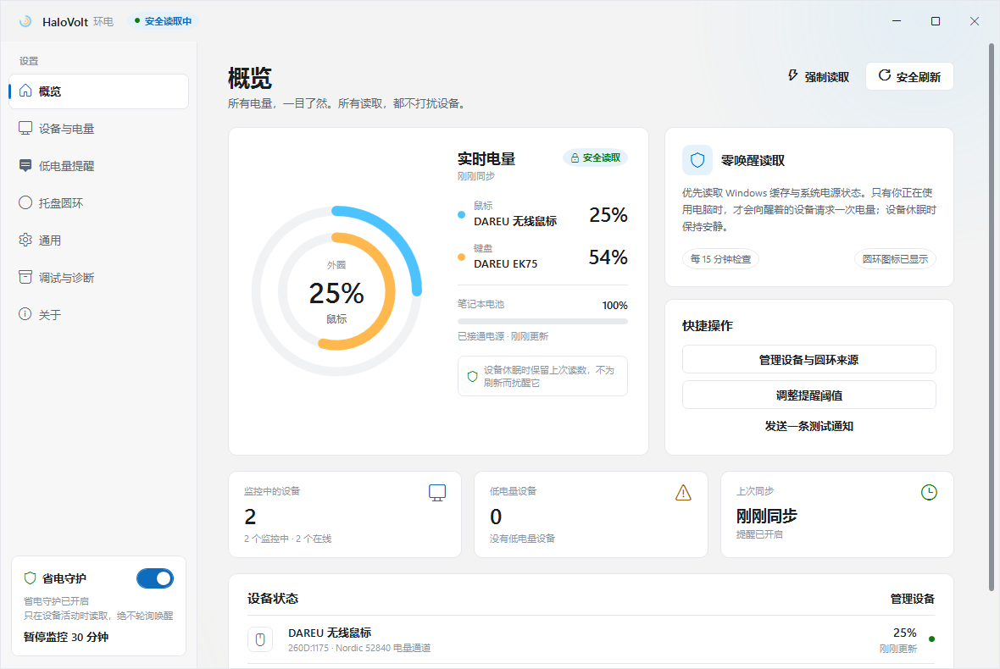
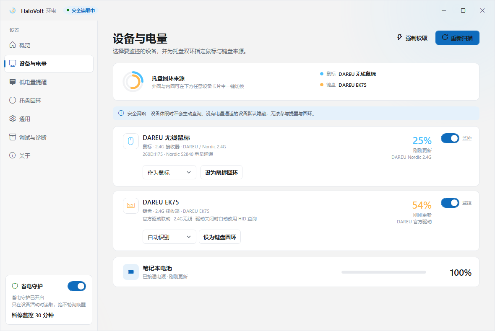
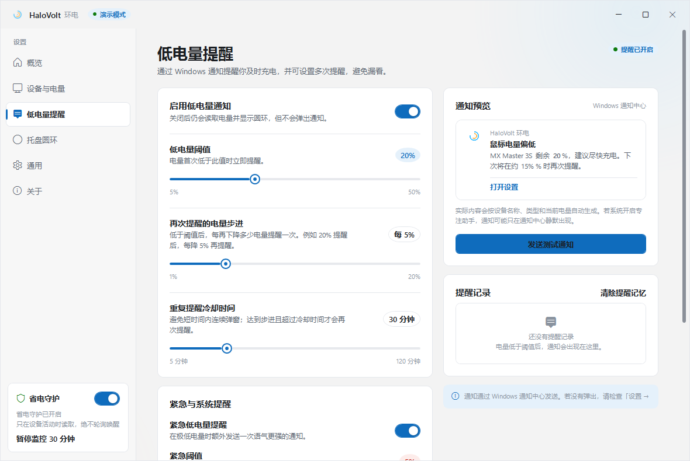
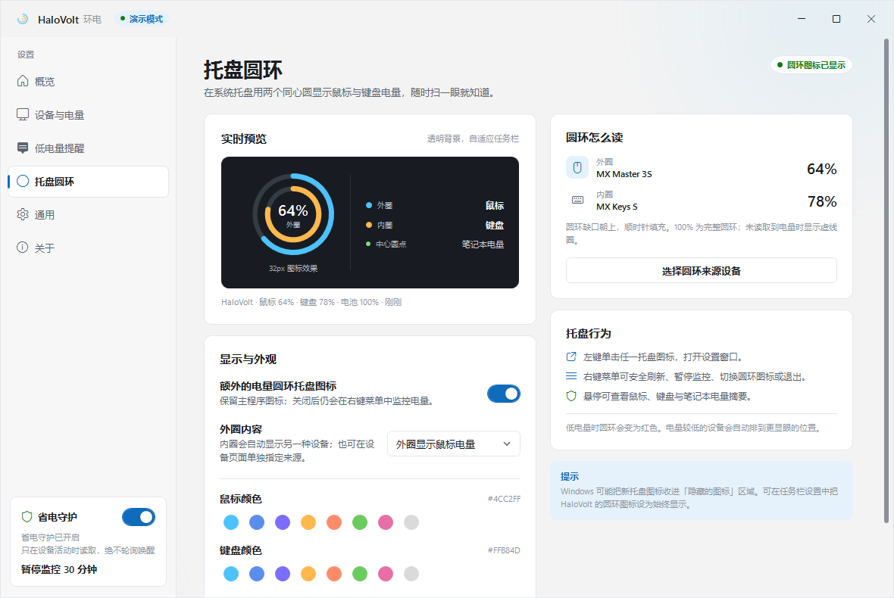
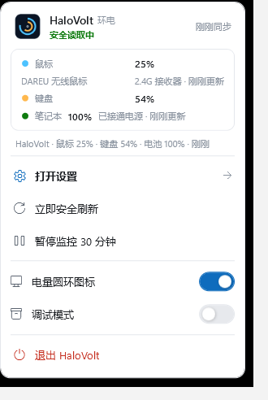
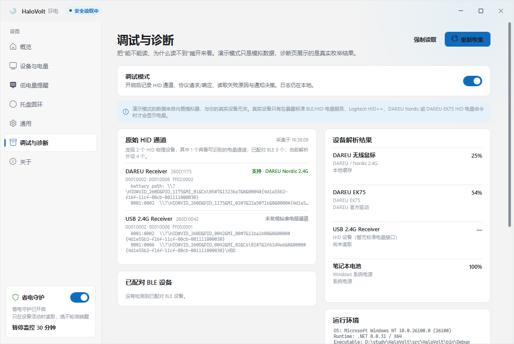
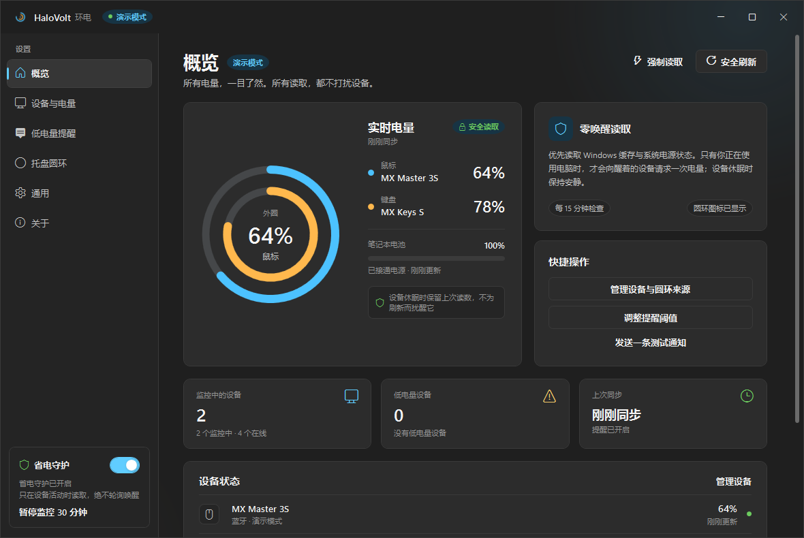

# HaloVolt 环电

> 轻量、克制的无线键鼠与笔记本电量托盘。  
> 让每一格电量，都心中有数。

HaloVolt 是一个 Windows 10/11 桌面小工具：读取无线鼠标、键盘与笔记本电池电量，用两个同心圆环显示在托盘里，并在设定阈值通过 Windows 通知提醒。它优先使用缓存与设备活动状态，默认不会为了刷新数字而主动唤醒休眠设备。



## 功能

- **鼠标 / 键盘双环托盘图标**：外圈、内圈分别对应鼠标和键盘，圆弧完整度就是电量；可自由指定哪个是鼠标、哪个是键盘。
- **独立的电量托盘图标**：保留主程序图标，可额外显示一个透明双环图标，也可随时关闭。
- **设备选择**：同时连接多个键鼠/接收器时，逐个选择是否监控、实际是鼠标还是键盘，以及圆环使用哪台设备。
- **低电量通知**：Windows 通知中心；阈值、每下降 N% 再提醒、冷却时间、紧急阈值、提示音、断连提醒、笔记本电池提醒均可设置。
- **笔记本电池**：使用 `GetSystemPowerStatus`，不常驻 WMI。
- **Win11 风格设置页**：浅色/深色/跟随系统，Fluent 卡片、开关、滑杆、自定义标题栏。
- **现代化托盘浮层**：右键显示带实时电量的 WPF 浮层，而不是老式系统菜单。
- **调试与诊断**：查看原始 HID 通道、设备解析、运行环境、日志；可导出诊断报告。
- **无电量通道的设备默认隐藏**：可在「通用」中改回显示；原始通道仍会在诊断页列出。
- **DAREU EK75 支持**：直接通过 65 字节厂商 HID 命令读取电量；官方 DAREU Driver 正在运行时优先使用其显示值，关闭驱动也能读。
- **缩到托盘提示**：可选择每次通过关闭/最小化隐藏到托盘时，是否用气泡提示一次。
- **开机自启与启动行为**：支持静默启动、启动后打开设置；不需要管理员权限。
- **轻量后台**：关闭设置窗口后释放界面；测试机静默托盘工作集约 20 MB。

## 界面

| 设备与电量 | 低电量提醒 |
| --- | --- |
|  |  |

| 托盘圆环 | 托盘右键浮层 |
| --- | --- |
|  |  |

| 图标细节 | 调试与诊断 |
| --- | --- |
|  |  |

深色主题：



## “不唤醒”策略

| 路径 | 行为 |
| --- | --- |
| Windows 系统电池 | 调用轻量 `GetSystemPowerStatus`，只读系统状态。 |
| 蓝牙 LE Battery Service | 先读 Windows GATT 缓存；只有设备已连接且近期有用户输入时，才尝试一次非缓存读取。 |
| DAREU / Nordic 52 鼠标 | 使用 `0xFF02:0x02` 电量集合；只有用户活动时发送一次 17 字节查询。 |
| DAREU Driver 联动（EK75） | 官方驱动运行时读取其窗口缓存值；驱动关闭时自动改用 65 字节 HID 电量命令，不依赖驱动常驻。 |
| Logitech HID++ | 仅在用户活动且启用主动读取时探测/查询，不按秒轮询。 |
| 标准 HID Battery Strength | 先无 I/O 探测能力；真正读取 feature report 前要求用户近期有输入。 |
| 强制读取 | 唯一明确会主动查询设备的入口，点击前会警告“可能唤醒已休眠设备”。 |

> 现实世界没有完美的“零唤醒”保证：部分厂商把电量藏在私有协议里；极少数一拖多接收器在探测其他设备时可能触达休眠设备。若希望绝对不主动查询，请在「通用 → 电量读取策略」关闭“允许在设备活动时主动读取”。

## 支持协议与实测设备

- **Bluetooth LE Battery Service**：`0x180F` / `0x2A19`。
- **DAREU / Compx / Nordic 52840 鼠标**：接收器 `VID_260D`，`0xFF02:0x02` 的 17 字节事务；本机 `DAREU Receiver`（`260D:1175`）读取到鼠标 **25%**。
- **DAREU EK75**：官方驱动运行时优先读取其显示值；驱动关闭时直接发送 65 字节 HID feature 命令（Power Management / Battery Status），本机读取到 **54%**。无需管理员权限，也不依赖 DAREU Driver 常驻。
- **Logitech HID++ 2.0**：直连或 Unifying/Bolt 接收器；特性 `0x1004` / `0x1000` / `0x1001`。
- **标准 HID Battery Strength**：Generic Device Controls（Usage Page `0x06`）中的 Battery Strength（Usage `0x20`）。
- **系统电池**：笔记本内置电池。

### 关于 DAREU EK75

EK75 的 2.4G HID 接口没有标准 Battery Service，但它有一个 65 字节厂商 feature 通道，实现了 DAREU 的 `Power Management / Battery Status` 命令。HaloVolt 直接发送这条查询并解析返回的当前/满电值；本机实测 **54%**。

- 官方 DAREU Driver 正在运行时，优先读取驱动窗口已显示的值，避免和驱动争用同一通道。
- 关闭 DAREU Driver 后，HaloVolt 会自动改用直接 HID 查询；不需要驱动常驻。
- 可在「通用 → DAREU EK75 支持」关闭这个功能。
- 读取不会抓取键盘按键，也不会为了刷新主动唤醒键盘；设备休眠时保留上次缓存值。

### 为什么演示模式“看得到”设备？

演示模式由 `DemoBatteryProvider` 注入两条模拟数据（MX Master 3S / MX Keys S）；同时真实 HID 扫描仍会运行。  
因此你在设备页看到的 DAREU 行是**真实枚举出来的接收器**，不是演示注入的 EK75；演示数据不会读取任何真实硬件，也不能证明键盘支持电量。EK75 的真实电量来自 HID 电量命令（官方驱动运行时优先读驱动值）。

## 使用

1. 运行 `HaloVolt.exe`。
2. 第一次启动会打开设置页。连接设备并唤醒一次，让 Windows 识别。
3. 「设备与电量」中选择监控、设备类型和圆环来源。
4. 「低电量提醒」中设置阈值、步进、冷却与紧急阈值。
5. 「托盘圆环」中确认外圈/内圈、颜色和中心圆点。
6. 「通用」中设置自启、启动/关闭行为、隐藏无电量通道设备、缩到托盘提示。
7. 读不到时打开「调试与诊断」，复制或导出报告。

### 托盘

- 左键单击任一托盘图标：打开设置。
- 右键：打开带实时鼠标/键盘/笔记本电量的浮层；可安全刷新、暂停、切换圆环图标、开关调试模式、退出。
- 关闭窗口默认缩到托盘；可在「通用」改为直接退出。
- 可在「通用 → 缩到托盘时提示一次」开启每次隐藏时的气泡提醒。

### 通知

- 使用 Windows 通知中心，无需管理员权限。
- 首次低于阈值提醒；之后每下降指定百分比并超过冷却时间再提醒；紧急阈值单独提醒一次。
- 可在「低电量提醒」中发送测试通知或查看提醒记录。
- 没有弹窗时检查 Windows「设置 → 系统 → 通知」是否允许 HaloVolt，以及专注助手/勿扰状态。

## 调试与诊断

- 开关位于「调试与诊断」页、托盘浮层，也可用 `--debug` 启动。
- 记录 HID 通道、协议请求/响应、读取失败原因、通知决策。
- 诊断页显示原始 HID 设备的 usage page、VID/PID、provider 判断、缓存值、错误、BLE 设备、运行环境和最近日志。
- 可复制报告或导出到 `%LOCALAPPDATA%\HaloVolt\diagnostics-*.txt`。

## 构建

要求：Windows 10 2004+ / Windows 11 x64、.NET 8 SDK。

```powershell
cd HaloVolt
dotnet build .\HaloVolt.sln
dotnet run --project .\src\HaloVolt\HaloVolt.csproj
```

### 发布

```powershell
# 框架依赖单文件，需要 .NET 8 Desktop Runtime
.\scripts\publish.ps1

# 自包含便携版
.\scripts\publish.ps1 -SelfContained
```

输出在 `dist\`。安装到当前用户：

```powershell
.\scripts\install.ps1
```

### 命令行

| 参数 | 作用 |
| --- | --- |
| `--open` / `--settings` / `--show` | 启动后打开设置 |
| `--page=Devices` | 直接打开指定页面（`Overview` / `Devices` / `Alerts` / `Tray` / `General` / `Diagnostics` / `About`） |
| `--silent` | 本次静默启动，仅显示托盘 |
| `--demo` | 注入演示数据（会写入设置） |
| `--debug` | 开启详细日志 |
| `--tray-menu` | 在当前鼠标位置打开托盘浮层，便于 UI 调试 |
| `--autostart` | 由开机启动项使用 |

## 数据与隐私

- 不联网、不发送遥测、不安装内核驱动、不注入其他进程。
- 设置：`%LOCALAPPDATA%\HaloVolt\settings.json`
- 日志：`%LOCALAPPDATA%\HaloVolt\halovolt.log`（超过 1 MB 自动轮转）
- 通知身份：`HKCU\Software\Classes\AppUserModelId\HaloVolt.Desktop`
- 协议：`halovolt://`，用于通知按钮
- 开机自启：`HKCU\Software\Microsoft\Windows\CurrentVersion\Run`，无需管理员权限

## 已知限制

- 电量百分比取决于设备/Windows 的上报口径；Logitech 电压换算可能与 G HUB 略有差异。
- DAREU 目前覆盖 Nordic 52 鼠标协议与 EK75 的 65 字节 HID 电量命令；其他 DAREU 型号需要单独适配。
- 其他私有 2.4G 协议、input-only vendor collection 无法主动查询。
- 设备休眠时保留上次成功读取的值，界面会显示“本地缓存”和较旧时间。
- “不唤醒”是默认策略，不是对所有硬件的绝对保证。
- 仅简体中文界面；无自动更新；未代码签名，可能触发 SmartScreen。
- 无电量通道的设备默认隐藏；可在「通用 → 隐藏不支持读取的设备」恢复显示。

## 项目结构

```text
HaloVolt/
├─ src/HaloVolt/              # WPF 应用
│  ├─ Controls/               # BatteryRing 双同心圆
│  ├─ Models/                 # 设置、设备、电量模型
│  ├─ Providers/              # BLE / DAREU Nordic / DAREU EK75 / Logitech HID++ / HID / Demo
│  ├─ Services/               # 通知、托盘、主题、设备监控、诊断、自启
│  ├─ Themes/                 # 浅色/深色与 Fluent 样式
│  ├─ ViewModels/
│  └─ Views/                  # 概览、设备、提醒、托盘、通用、调试、关于
├─ tests/HaloVolt.Tests/      # 低电量策略测试
├─ scripts/                   # 构建、发布、安装
├─ docs/screenshots/
└─ tools/make_icons.py
```

## 测试

```powershell
dotnet test .\HaloVolt.sln
```

覆盖阈值、重复步进、冷却、紧急提醒、充电抑制、回到阈值以上后的状态重置。

## 致谢

HID++ 2.0 参考 Logitech 特性文档与开源社区 Solaar、LGSTrayBattery 的协议说明；DAREU / Nordic 52 报文格式参考 [Fan4Metal/mouse_tray](https://github.com/Fan4Metal/mouse_tray)。本项目为独立实现，未复制其代码。  
界面使用 .NET 8 / WPF / Windows 原生通知 API，无第三方 UI 运行时。

## License

MIT © 2026 HaloVolt contributors. 详见 [LICENSE](LICENSE)。
